# GritMap

GritMap helps cyclists plan an effort for a climb or segment, execute that plan live on a
Hammerhead Karoo, and review what happened afterward on an iPhone.

The project is preparing for a small public beta. Segments are intended to stay open and
shareable; live pacing and ride data remain local to the rider's devices.

## What you need

GritMap is built for riders with a **power meter and a heart-rate monitor**. Pacing plans are power
targets, and the live guidance, energy budget and cardiac fields depend on both. Without a power
meter GritMap can still match segments and show progress, but it cannot do what it is for.
It also needs a **Hammerhead Karoo 3** and an **iPhone** for this beta. Karoo 2, iPad and Android
phones are not supported yet.

## How it works

1. **Get a segment.** Import a FIT file on the iPhone and define a segment, or pull one from
   [Open Segments](https://opensegments.org), the open catalogue of climbs and segments. Segments are
   public lines on a map; your rides and plans stay on your own devices.
2. **Set a goal and get a pacing plan.** The iPhone turns your goal finish time into a
   section-by-section power plan, or imports one from a coach.
3. **Send it to the Karoo over Bluetooth.** The plan and segment go phone to Karoo directly: no
   server, no IP address to type, and it works with no signal. A local network route remains as a
   fallback.
4. **Ride it.** The Karoo extension matches the segment, follows the plan live and shows target
   power, progress and a finish projection in its data fields.
5. **Review it.** Import the finished ride's FIT file on the iPhone and compare the effort with the
   plan and with your earlier attempts on the same segment.

Automatic sync of finished rides from the Karoo to the phone is planned; manual FIT import is
what the beta uses.

## Open Segments

[opensegments.org](https://opensegments.org) is a free, open catalogue of segments. Anyone can browse and
open one in a map view. Segments you publish are listed publicly by default, with an optional link-only
mode for sharing with friends. Accounts use an emailed code and a generated rider name, never your real
name. Connecting the iPhone app to Open Segments (searching, pinning and publishing from the app) is in
development.

## The iPhone app

Screens from the TestFlight build in dark mode, using synthetic sample rides and segments (the routes are
generated, not real rides).

<p>
  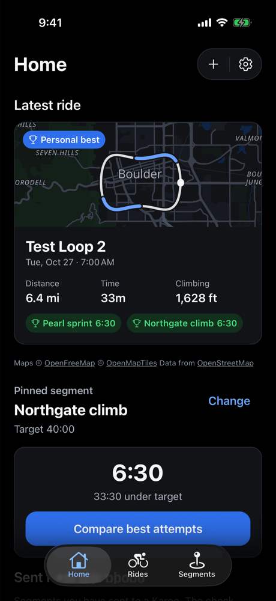
  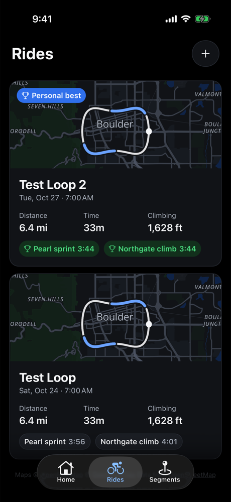
  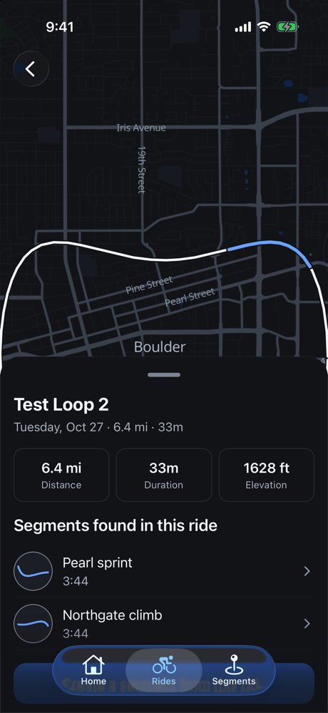
  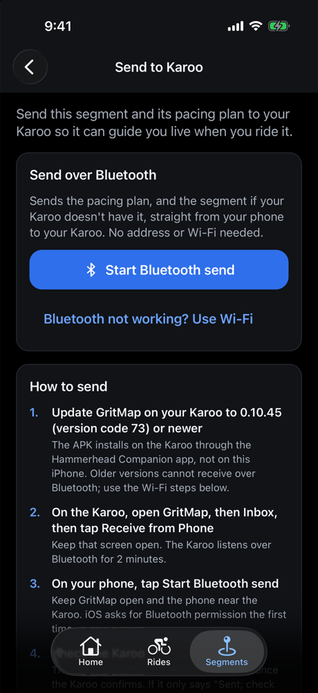
</p>

Home and Rides show your latest rides and results; a ride lists the segments found in it; Send to Karoo
moves a segment and its plan to the Karoo over Bluetooth.

## Karoo 3 extension

The current extension requires a **Hammerhead Karoo 3**. Karoo 2 is not supported by this beta.

### Install with Hammerhead Companion

1. On your phone, long-press [`gritmap-karoo.apk`](https://github.com/frason/GritMap/releases/latest/download/gritmap-karoo.apk)
   without opening or downloading it.
2. Choose **Share Link**, then select **Hammerhead Companion**. Do not first download the APK and
   share it from Files; on iPhone that file-transfer route can leave the Karoo on a UUID-named
   loading screen without delivering the APK.
3. Keep the Karoo on Wi-Fi while it retrieves the GitHub URL.
4. Approve the installation on the Karoo, then open **GritMap** from its app list.
5. Follow the [Karoo beta setup guide](docs/BETA_KAROO_INSTALL.md) to grant permissions and add
   GritMap fields to a ride profile.

Advanced fallback with Android Debug Bridge:

```bash
adb install -r gritmap-karoo.apk
```

Every beta APK is signed with the same GritMap beta identity. Install updates over the existing
app so the Karoo retains locally stored segments, plans, settings, and diagnostics.

## Live data fields

Images are **development previews rendered from synthetic test data**, in dark mode. They are not
photographs of a Karoo, and the released APK may look slightly different.

| Field | What it answers | Preview |
|---|---|---|
| **GM Pacing Profile / Pacing Coach** | What is my target power now, how do I compare, and what effort comes next? | 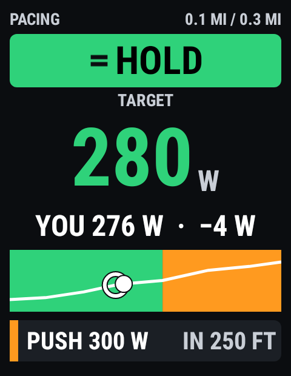 |
| **GM Segment Performance** | What is my projected finish and where am I gaining or losing time? | 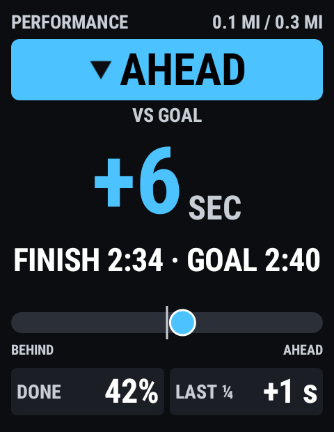 |
| **GM Power Balance** | Am I spending modeled reserve faster or slower than planned? | 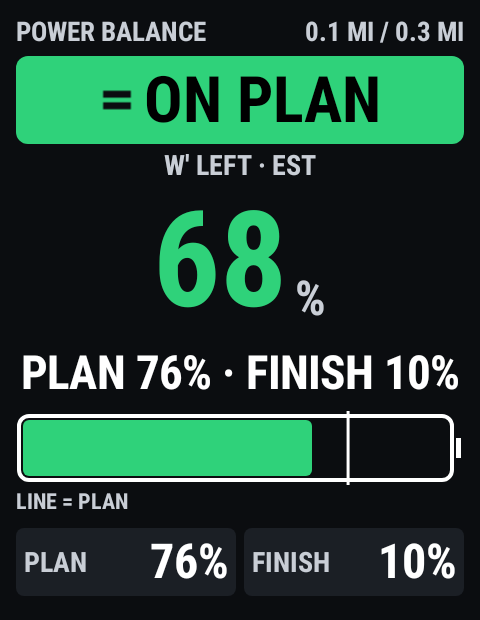 |
| **GM Cardiac Drift** | Is power-to-heart-rate efficiency changing? | 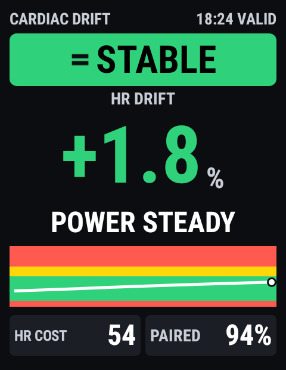 |
| **H10 Cardiac** (optional, experimental) | Is clean Polar H10 RR context available, and how is it trending? | 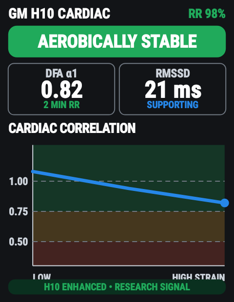 |

Also available as text-only fields: target power, difference between target and current power, and
estimated completion time.

**In development, not in the public beta yet:**

| Field | What it answers | Preview |
|---|---|---|
| **GM Recent Segments** | How did my latest completed segments go against their goals? The newest result gets a short shrinking highlight. | 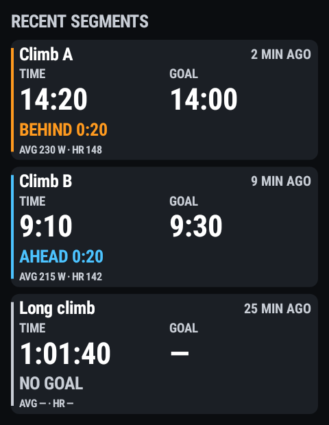 |
| **Cardiac baseline countdown** | How much more steady riding does Cardiac Drift need, and what is it waiting for? | 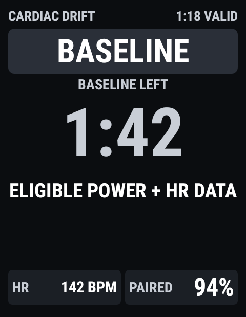 |

These are advisory training displays, not medical measurements or guarantees of performance.

## Join the iPhone TestFlight beta

The companion app beta is **iPhone-only** for now. An iPad layout and Android phone app are not
part of this first test.

**[Join the TestFlight beta](https://testflight.apple.com/join/rgnsx1PG)** (open it on your iPhone; it asks you to install Apple's
TestFlight app first). The beta is limited in size, so the link may be full. Then install the Karoo extension with the
[Karoo install guide](docs/BETA_KAROO_INSTALL.md). Please do **not** post your Apple ID or private email address in a public GitHub issue.

Beta testers should be willing to:

- install a prerelease Karoo extension;
- report the app and extension version with problems;
- share screenshots and, only when comfortable, relevant FIT or diagnostic files privately;
- remember that pacing and physiology features are experimental and advisory.

## Development

- Product direction and current status: [docs/GOALS.md](docs/GOALS.md)
- Karoo build and test setup: [apps/karoo/README.md](apps/karoo/README.md)
- TestFlight preparation: [docs/BETA_TESTFLIGHT.md](docs/BETA_TESTFLIGHT.md)
- Privacy policy draft: [docs/PRIVACY.md](docs/PRIVACY.md)

The Karoo application is Apache-2.0 licensed. See [apps/karoo/LICENSE](apps/karoo/LICENSE).
